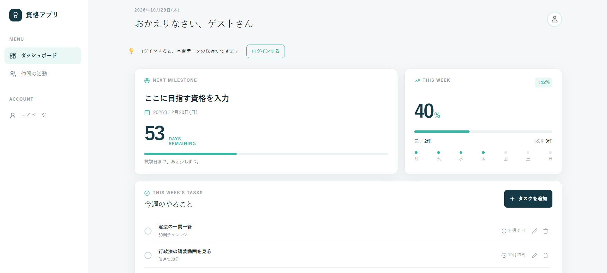

# 資格試験スケジュール・進捗管理アプリ
サイトURL
https://portfolio-app-lac-five.vercel.app/

## アプリのスクリーンショット
)

## 概要
日々の忙しさで勉強ペースが分からなくなり、試験日から逆算したスケジュール管理に焦ってしまう悩みを解決するためのアプリです。
試験日までのカウントダウンと今週の「やることリスト」の進捗率を可視化し、同じ試験を目指す仲間同士で進捗を共有し合える機能を提供します。

## 使用技術
- **フロントエンド**: Next.js (React)
- **バックエンド / データベース**: Supabase (タスクのCRUD操作、進捗率の計算・動的更新)
- **言語**: JavaScript / TypeScript, HTML, CSS

## 設計ドキュメント
- [要件定義・基本設計・詳細設計の一覧_Googleスプレッドシート](https://docs.google.com/spreadsheets/d/1tbVLJUGC10qk153rosC2VPLfzc03KVuVpmChb3KjTwA/edit?gid=0#gid=0))
- 詳細設計時のワイヤーフレーム、ER図の画像は docsディレクトリに格納しています [（こちらからアクセス）](https://github.com/ayan11141/Portfolio/tree/main/docs)

## 機能一覧
- ユーザー登録、ログイン機能（メールアドレスとGoogleアカウント）
- 試験日までのカウントダウン機能
- タスクの追加・編集・削除・完了ステータス管理（CRUD操作）
- 進捗率の視覚的な可視化（グラフ・ボード形式）
- 同じ試験を目指す仲間同士の進捗共有機能
